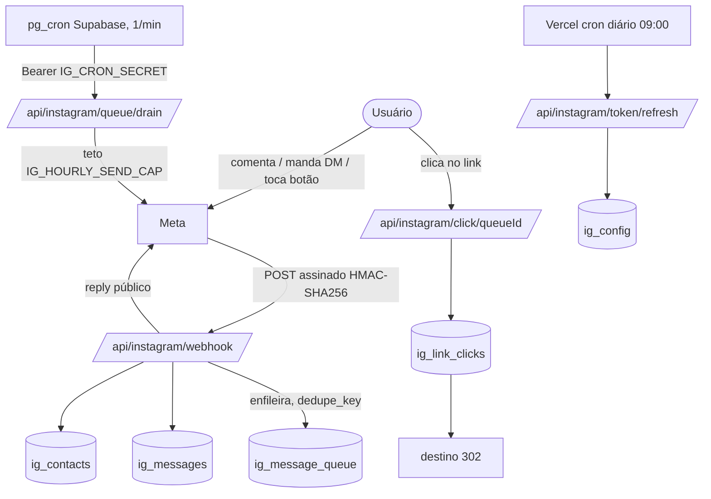

# 📐 Documentação Técnica: Área de Automação (Instagram / PraticChat)

> **Sistema:** PraticSystem (Agência Pratic / Pratic Labs)
> **Módulo:** `/automacao-instagram` (PraticChat) + materiais públicos (`/materiais`) + prospecção WhatsApp (`/prospeccao`)
> **Atualizado em:** 2026-10-17 (revisado contra o código; substitui a versão anterior, que não cobria inbox, materiais, boas-vindas, token refresh e publicação)
> **API:** Instagram API with Instagram Login, `https://graph.instagram.com/v25.0` (`src/lib/instagram.ts:5`). Não usa Graph do Facebook nem `pages_*`.

---

## 1. Visão geral

Substituto nativo do ManyChat para o perfil pessoal @juli0net0 / @julioneto.ia:

1. **Comentário → DM:** o seguidor comenta uma palavra-chave e recebe o material por DM, mais resposta pública (com variações).
2. **Follow Gate:** só entrega se seguir o perfil.
3. **Inbox:** receber, responder (janela de 24h) e importar histórico de DMs.
4. **Materiais:** biblioteca de iscas (texto, arquivo, link) com páginas públicas `/materiais`.
5. **Boas-vindas** na primeira DM, **rastreamento de cliques**, **números do perfil**.
6. **Publicação de Reel por API** (embrião, ver §9).

---

## 2. Arquitetura

---

## 3. Páginas (UI)

Acesso a `/automacao-instagram/*` (exceto `/login`) protegido por `src/proxy.ts` (cookie `ig_admin_session`).

| Rota | Arquivo | Função |
|---|---|---|
| `/automacao-instagram` | `page.tsx` + `AutomationsClient.tsx` | Painel com 8 abas |
| `/automacao-instagram/login` | `login/page.tsx` | Login por senha |
| `/automacao-instagram/resultados` | `resultados/page.tsx` | Funil comentários → DMs → cliques |
| `/automacao-instagram/materiais` | `materiais/page.tsx` | Redirect para `?tab=materials` |
| `/materiais`, `/materiais/[slug]` | `src/app/materiais/*` | **Públicas**: vitrine e página do material |
| `/bio` | `src/app/bio/*` | Link da bio (UTM) |
| `/instagram-privacidade`, `/instagram-exclusao-dados` | páginas | Exigidas pela Meta |

**Abas do painel:** `home` (KPIs, séries, perfil, checklist), `contacts`, `automations` (CRUD + simulador + editor em `automation-editor/*`), `materials` (`dashboard/MaterialsManager.tsx`), `inbox` (`InboxView.tsx`), `results`, `settings` (OAuth, expiração do token, boas-vindas), `ai` (**placeholder**, só atalhos para templates). `InstagramPostPicker.tsx` escolhe o post gatilho via `/api/instagram/media`.

Aba `publications`: agendamento de posts (ver §9).

---

## 4. APIs

Rotas "sessão" usam `requireIgSession()`.

| Rota | Métodos / auth | Função |
|---|---|---|
| `webhook` | GET/POST públicas | GET: handshake `hub.verify_token` = `IG_WEBHOOK_VERIFY_TOKEN`. POST: valida `x-hub-signature-256` (HMAC com `IG_APP_SECRET`, 403 se inválida), sempre responde 200 `EVENT_RECEIVED`. Trata `comments`, `messages`, `postback`, `quick_reply`, `is_echo` |
| `oauth/start` | GET sessão | Redireciona para `instagram.com/oauth/authorize` |
| `oauth/callback` | GET | code → token curto → token longo (60d); grava `ig_config` (apaga a anterior); assina webhooks |
| `token/refresh` | GET/POST cron ou sessão | Renova se faltarem <15 dias; `?force=1` força; expirado → 409 |
| `queue/drain` | POST Bearer `IG_CRON_SECRET` ou sessão | Esvazia a fila respeitando o teto horário |
| `click/[queueId]` | GET pública | Registra clique e redireciona |
| `automations`, `automations/[id]` | CRUD sessão | Regras |
| `materials`, `materials/[id]` | CRUD sessão | Materiais, upload via formData |
| `inbox`, `inbox/[igsid]`, `inbox/import` | sessão | Conversas, mensagens/resposta (bloqueia fora das 24h), importação |
| `contacts/backfill` | POST sessão | Completa @, nome e foto (lotes de 25) |
| `settings` | GET/PUT sessão | Boas-vindas (`ig_settings`) |
| `media` | GET sessão | Perfil, posts e insights |
| `publish` | POST sessão | Publica Reel (§9) |
| `auth/login`, `auth/logout` | POST | Senha `IG_ADMIN_PASSWORD` |
| `/api/materiais/[slug]/download` | GET pública | Download do material |

**Endpoints Meta usados:** `/{ig}/messages` (texto, template `web_url`/`postback`, `quick_replies`; destinatário `id` ou `comment_id`), `/{comment}/replies`, `/{ig}/subscribed_apps` (`comments,messages,messaging_postbacks`), `/{igsid}` (follow, nome, foto), `/me`, `/me/media`, `/{media}/insights`, `/me/insights`, `/me/conversations`, `ig_exchange_token`, `refresh_access_token`, `/{ig}/media`, `/{container}`, `/{ig}/media_publish`.

---

## 5. Banco (Supabase)

RLS ligado e **sem policies** em todas as `ig_*`: acesso só por `service_role`. Migrations soltas na raiz (`migration_instagram_*.sql`).

| Tabela | Conteúdo |
|---|---|
| `ig_config` | Conta conectada: `ig_user_id`, `ig_username`, `access_token` (texto puro), `token_expires_at` |
| `ig_automations` | `post_id` (nulo = qualquer), `keywords[]`, `match_mode`, `comment_reply_text(s)`, DM, botão, `cta_type` (`link`/`button`/`quick_reply`), `require_follow`, `linked_material_id` |
| `ig_contacts` | `igsid`, `username`, `name`, `profile_pic_url`, `source`, `interactions`, `is_follower`, `welcomed_at` |
| `ig_message_queue` | Fila de **DMs**: `status` pending/sending/sent/failed, `attempts`, `error`, `dedupe_key` UNIQUE, `comment_id` |
| `ig_link_clicks` | `queue_id`, `automation_id`, `igsid`, `clicked_at` |
| `ig_logs` | `level`, `event`, `payload` JSONB |
| `ig_messages` | Inbox: `mid` UNIQUE, `direction`, `kind`, `text`, `attachments`, `source`, `read_at` |
| `ig_settings` | Linha única (`id=1`): boas-vindas |
| `ig_materials` | `slug` UNIQUE, `material_type` text/file/link, `copy_text`, `file_path`, `cover_image_path`, `view_count` |

RPC `increment_ig_material_views(p_slug)`. Bucket público `ig-materials` (uploads só pelo servidor). `migration_instagram_use_button.sql` é legado (substituída por `_cta_type`).

**Prospecção (WhatsApp, outro canal):** `leads`, `campaigns`, `campaign_recipients`, `lead_messages`, `lead_activities`, `quick_replies`, `scheduled_messages`; bucket `prospeccao-media`; provedor UAZAPI.

---

## 6. Mecanismos

- **Match:** `findMatchingAutomation`, com `post_id` e modo `contains`/`exact`.
- **CTAs:** `link` (passa pelo redirect de clique), `button` (postback → 2ª mensagem), `quick_reply`.
- **Follow gate:** consulta `is_user_follow_business`; se não segue, envia aviso com botão; ao tocar, reavalia. Falha da API libera o conteúdo.
- **Fila:** dedupe por `commentId:automationId`; teto `IG_HOURLY_SEND_CAP` (padrão 60); primeiro envio por `comment_id` (resposta privada, vale fora das 24h).
- **Variáveis** nas mensagens (`{first_name}`, `{username}`) e **boas-vindas** na primeira DM.

---

## 7. Autenticação, tokens e crons

- **Escopos OAuth** (`oauth/start/route.ts:15`): `instagram_business_basic`, `_manage_messages`, `_manage_comments`, `_content_publish`.
- **Token:** longo (60d), renovado pelo cron diário.
- **Crons:** Vercel (`vercel.json`): `reminders` 11:00 e 20:00 (não é Instagram) e `token/refresh` 09:00. Supabase pg_cron (`migration_instagram_cron.sql`): `ig-drain-queue` a cada minuto. **`queue/drain` não está no `vercel.json`**; confirmar que o pg_cron foi aplicado em produção (arquivo traz placeholder do segredo). Prospecção: `prospeccao-housekeeping` de hora em hora.
- **Variáveis:** `IG_APP_ID`, `IG_APP_SECRET`, `IG_WEBHOOK_VERIFY_TOKEN`, `IG_OAUTH_REDIRECT_URI`, `IG_ADMIN_PASSWORD`, `IG_CRON_SECRET`, `IG_SESSION_SECRET`, `IG_HOURLY_SEND_CAP`; opcional `CRON_SECRET` (só no `token/refresh`); Supabase; `WA_*`/`UAZAPI_*` para prospecção.

### Pontos de atenção de segurança
- O cookie `ig_admin_session` contém o próprio `IG_SESSION_SECRET` (1 ano, sem revogação).
- `access_token` guardado em texto puro (protegido só por RLS/service_role).

---

## 8. Prospecção WhatsApp (resumo)

Rotas `src/app/api/prospeccao/*` (webhook com `WA_WEBHOOK_SECRET`, `schedule`, `campaigns/send`, `capture` pública com honeypot, etc.). O **agendamento aqui é de WhatsApp**, delegado à UAZAPI e espelhado em `scheduled_messages`. Não se aplica a posts do Instagram.

---

## 9. Publicação e agendamento no Instagram

### Como funciona (implementado em 2026-10-17)
- **Aba "Publicações"** (`dashboard/PublicationsManager.tsx`): lista, nova publicação (Reel, imagem, carrossel 2–10, story), agendar ou "Agora", cancelar, tentar de novo, excluir.
- **Upload:** o navegador pede `POST /api/instagram/scheduled-posts/upload-url` e envia o arquivo direto ao bucket público `ig-posts` por URL assinada (vídeo passa do limite de 4,5 MB da Vercel).
- **Tabela `ig_scheduled_posts`** (`migration_instagram_scheduled_posts.sql`): `post_type`, `media` JSONB `[{url,kind}]`, `caption`, `cover_url`, `share_to_feed`, `scheduled_at`, `status` (pending/publishing/published/failed/canceled), `attempts`, `error`, `media_id`, `permalink`.
- **API:** `scheduled-posts` (GET/POST), `scheduled-posts/[id]` (PATCH editar/cancelar/reagendar, DELETE), `scheduled-posts/run` (GET/POST, Bearer `IG_CRON_SECRET`/`CRON_SECRET` ou sessão).
- **Runner:** o pg_cron do Supabase chama `run` a cada minuto (job `ig-publish-scheduled`, na própria migration). Reivindica cada post com UPDATE atômico `pending → publishing`, publica até 3 por execução e para perto de 200 s. Post preso em `publishing` por mais de 15 min vira `failed` (não reenvia sozinho, para não duplicar no perfil).
- **Publicação** (`src/lib/instagramPublish.ts`): imagem, story e carrossel (container por item + container pai `CAROUSEL`) com polling de `status_code`; Reel reaproveita `publishInstagramReel`. Busca o `permalink` ao final.
- **Validação** pura e testada: `src/lib/instagramPosts.ts` (+ `.test.ts`).
- `POST /api/instagram/publish` (Reel imediato por URL) continua existindo.

### Para ativar
1. Rodar `migration_instagram_scheduled_posts.sql` no SQL Editor (trocar `COLE_AQUI_O_IG_CRON_SECRET` na hora; confirmar o bucket `ig-posts` público).
2. Deploy na Vercel.

### ⚠️ Pendências e riscos
- **Escopo `instagram_business_content_publish` não verificado.** O commit `e4fc6ca` removeu `manage_insights` por não estar aprovado ("API access blocked"). Validar no painel da Meta e com um post real. Se o token atual foi emitido antes do escopo existir, reconectar a conta.
- **Nada disso foi testado contra a API da Meta** (só a validação tem teste automatizado).
- Sem retry automático (falha exige "Tentar de novo"), sem checagem de `content_publishing_limit` (100/24 h), sem validação de codec/proporção do vídeo, uma conta só.
- Story em vídeo e carrossel com vídeo podem demorar mais que a janela de polling.

## 10. Resumo implementado vs. pendente

| Área | Estado |
|---|---|
| Comentário → DM, follow gate, CTAs, boas-vindas, webhook, fila, cliques | ✅ |
| OAuth, token longo e renovação | ✅ |
| Inbox, contatos, materiais, insights | ✅ |
| Prospecção WhatsApp | ✅ (outro canal) |
| Publicação/agendamento (Reel, imagem, carrossel, story) | 🟡 implementado, **não testado na Meta** |
| Aba "Pratic AI" | 🟡 placeholder |
